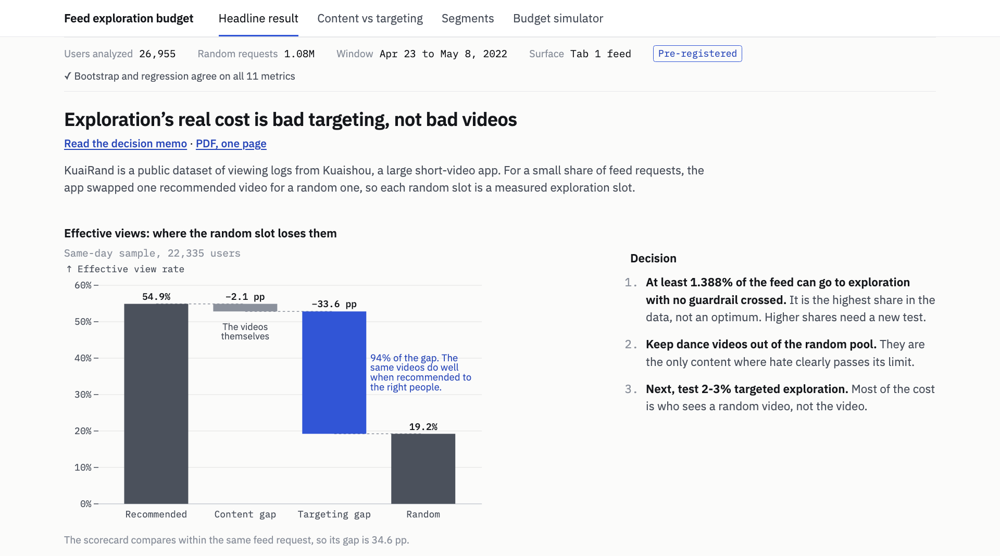
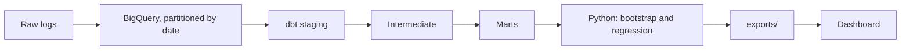

# Feed exploration budget

**Exploration’s real cost is bad targeting, not bad videos.**

How much of a short-video feed should go to exploration, and what does it cost? An analysis of randomized slots in a public dataset.

[](https://github.com/hansonyjy/feed-exploration-experiment/actions/workflows/pages.yml)

**[Live dashboard](https://hansonyjy.github.io/feed-exploration-experiment/)** · **[Decision memo (PDF)](docs/memo.pdf)** · [Findings](docs/findings.md) · [Pre-registered plan](docs/analysis_plan.md)

[](https://hansonyjy.github.io/feed-exploration-experiment/)

## The answer

- **A random slot costs 34.6 pp of effective views (−63%)** compared with a recommended slot in the same feed request.
- **94% of that gap is targeting, not content.** The random pool's videos do almost as well when they are recommended. In the best case, where a targeted slot reaches people as well as the recommender does, a slot would cost about 2.1 pp instead of 35.7 pp (an upper bound).
- **Content matters more than users.** Random gaming videos cost 42.2 pp and comedy 28.3 pp, while user groups differ by a few points.
- **Guardrails hold for the whole feed, except for dance.** At 1.388%, hate rises 1.60% and fast skip 1.32% relative to their current rates, both under the 2% limit; dance videos push hate past it even at 0.658%.

- **The feed-level cost is small.** At 1.388%, exploration lowers the feed's effective-view rate by 0.48 pp, 0.88% of its current rate.

**Recommendation:** exploration up to 1.388% of the feed is safe to keep, though its payoff is long-run and was not measured here. Keep dance out of the random pool, and next test 2-3% targeted exploration.

**Next experiment:** randomize by user for about four weeks across four arms (current random 1.388%, random 2%, targeted 2%, targeted 3%), with decision rules set before launch. The [decision memo](docs/memo.md) has the design, the rules and the sample sizes.

## The question and the data

A recommender that only shows what it already knows users like never learns anything new. Some share of the feed has to go to exploration: videos the system would not have picked. The question is how large that share can be before it hurts the experience, and whether the answer differs by content or by user.

[KuaiRand](https://kuairand.com/) is a public dataset of viewing logs from Kuaishou, a large short-video app. In some feed requests the app swapped a recommended video for a random one. Each random slot is therefore a measured exploration slot, and comparing it with the recommended videos in the same request measures what exploration costs (26,955 users, 1,081,088 random requests, April 23 to May 8, 2022).

## How this was built

323.5 million raw log rows · 27,285 users in the dataset · 32.0 million videos · 508 GB scanned in BigQuery · 25 dbt models · 231 tests

**Stack:** BigQuery · dbt · Python (pandas, pyfixest) · TypeScript and Observable Plot · GitHub Actions



Every number on the dashboard, in the memo and in this README comes from a committed export. CI checks that the dashboard data matches the exports and that every number in the memo and README traces to [findings.md](docs/findings.md) or an export.

## Method

- **Comparison:** each random video against the recommended videos in the same feed request, each user weighted equally.
- **Inference:** a user-clustered bootstrap (2,000 resamples), cross-checked with a fixed-effects regression with errors clustered by user. A result counts only if both methods find it with the same sign.
- **Pre-registration:** metrics, tests and parameters were fixed before any outcome was read.
- **Segments:** each segment is compared with the rest of its group, corrected with Benjamini-Hochberg and the stricter Benjamini-Yekutieli.
- **Primary metric:** duration-adjusted effective view: a view that lasts at least as long as the typical view of a similar-length video, so short videos are not favored the way plain completion favors them.
- **Robustness:** the results hold with AD-pool videos excluded, with the top 0.1% of user-days excluded, and when compared within each user.

The plan is frozen at the git tag [`prereg-v1`](https://github.com/hansonyjy/feed-exploration-experiment/tree/prereg-v1). Every later change is logged in the [decision log](docs/decisions.md), and changes made after results were seen are marked as post-results deviations.

## Calls that mattered

- **The insertion rate rose around May Day,** so the periods before and after are never compared; every comparison stays within a request or day ([D17](https://github.com/hansonyjy/feed-exploration-experiment/blob/main/docs/decisions.md#2026-11-16--d17--insertion-rate-regimes-and-the-may-day-holiday)).
- **Session exit showed an effect of about 5 pp, but it was mechanical:** random slots sit more often in a session's first request and final requests log fewer items, so session exit was declared not identifiable ([D53](https://github.com/hansonyjy/feed-exploration-experiment/blob/main/docs/decisions.md#2026-11-18--d53--session-exit-is-not-identifiable-from-these-logs)).
- **Plain completion favors short videos,** so the primary metric compares each view with the typical view of a similar-length video ([D2](https://github.com/hansonyjy/feed-exploration-experiment/blob/main/docs/decisions.md#2026-11-15--d2--one-pre-registered-primary-metric-duration-adjusted), [D29](https://github.com/hansonyjy/feed-exploration-experiment/blob/main/docs/decisions.md#2026-11-16--d29--effective-view-play_time_ms-at-or-above-the-bucket-median)).
- **Light users get more random slots,** so every comparison is made within a user first and users are weighted equally ([D21](https://github.com/hansonyjy/feed-exploration-experiment/blob/main/docs/decisions.md#2026-11-16--d21--hc-1-segment-criterion-non-blocking-equal-weight-per-user)).
- **The segment merge map was committed on its own before any segment outcome was read** (commit [9929e2c](https://github.com/hansonyjy/feed-exploration-experiment/commit/9929e2c), [D58](https://github.com/hansonyjy/feed-exploration-experiment/blob/main/docs/decisions.md#2026-11-20--d58--how-the-minimum-detectable-effect-merge-d39-d40-is-computed)).

## What this can't tell you

- **Anything above 1.388%.** No higher share was observed; that needs a new test.
- **Whether exploration pays off later.** Random slots also give fewer new-category effective views (1.21% vs 1.76%), so the short-run data shows no discovery benefit.
- **Before vs after May Day.** The insertion rate changed around the holiday, so the two periods are never compared.
- **Session exits.** Whether random slots end sessions early cannot be identified from these logs (decision D53).
- **Other apps and years.** This is one app, in 2022.

## Repository layout

```text
analysis/    Comparisons A, B and C, segments, the exploration budget, health checks
dbt/         Models (staging, intermediate, marts), tests and seeds
dashboard/   The static site (Vite, TypeScript, Observable Plot); reads only exports/
docs/        Design, pre-registered plan, decision log, data quality, findings, memo
exports/     Committed results the dashboard, memo and README read
scripts/     Loading, GCP setup, data builds, checks, memo and screenshot builds
```

## Reproduce

<details>
<summary>Set up GCP, load the data, build with dbt, run the analyses and rebuild the dashboard and memo.</summary>

**Prerequisites:** Python 3.12 with [uv](https://docs.astral.sh/uv/), Node 24, the Google Cloud SDK (`gcloud`, `bq`), and a GCP project with billing. Google Chrome is needed only to rebuild the memo PDF and the README screenshot.

**GCP setup.** Copy `.env.example` to `.env` and set `GCP_PROJECT`. Then authenticate and create the bucket and datasets:

```bash
gcloud auth application-default login
scripts/setup_gcp.sh            # prints the commands
scripts/setup_gcp.sh --apply    # runs them; safe to re-run
```

**Load the data.** Download KuaiRand-27K and the supplementary category file, point `KUAIRAND_DIR` at them in `.env`, then convert to Parquet, upload and load into BigQuery. The load writes [docs/load_manifest.md](docs/load_manifest.md) with row counts and hashes; raw data never enters the repo.

```bash
uv sync
uv run python scripts/load_kuairand.py all
```

**Build with dbt.** Copy `dbt/profiles.example.yml` to `dbt/profiles.yml` (it is git-ignored and holds no secrets; auth comes from `gcloud`). Work on `dev`, a 5% hashed user sample, by default; run `prod`, the full data, only for final results.

```bash
scripts/dbt.sh build --target dev
scripts/dbt.sh build --target prod
```

**Cost controls.** Every dbt profile sets `maximum_bytes_billed` (10 GiB per query on dev, 60 GiB on prod), new queries are dry-run first, raw logs are partitioned by date and clustered by user and video, and `scripts/bytes_billed.sh` reports the month's billed bytes.

**Run the analyses** (each takes `--target dev` or `--target prod`):

```bash
uv run python analysis/comparison_a.py --target dev
uv run python analysis/comparison_b.py --target dev
uv run python analysis/comparison_c.py --target dev
```

`analysis/segments.py`, `analysis/exploration_budget.py` and `analysis/bridge_b_c.py` follow the same pattern; prod results land in `exports/`.

**Rebuild the dashboard data, memo and screenshot:**

```bash
python scripts/build_dashboard_data.py      # exports/*.csv -> exports/dashboard/*.json
python scripts/memo_facts.py                # the memo's and README's derived numbers
scripts/build_memo_pdf.sh                   # docs/memo.pdf from docs/memo.md
scripts/screenshot_dashboard.sh             # docs/img/dashboard-page1.png
python scripts/check_memo.py                # numbers trace, PDF is current
cd dashboard && npm ci && npm run dev       # the site, locally
```

</details>

## Data and license

- **KuaiRand:** Gao et al., CIKM 2022 ([kuairand.com](https://kuairand.com/), [arXiv 2208.08696](https://arxiv.org/abs/2208.08696)), licensed CC BY-SA 4.0.
- **Video categories:** the KuaiRand supplementary files by Chongming Gao ([Zenodo 10.5281/zenodo.18159199](https://zenodo.org/records/18159199)), licensed CC BY 4.0.
- **Derived data** in `exports/` is shared under CC BY-SA 4.0. Raw data is not stored in this repo.

This project uses public data only.

---

Built by [Hanson Yang](https://github.com/hansonyjy).
