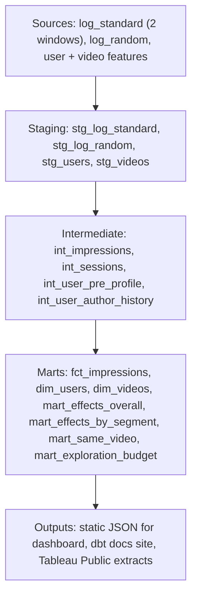

# Feed Exploration Experiment: Analysis Design Doc

Nov 15, 2026 · Hanson Yang. Living copy: https://claude.ai/artifact/VdySEjqtLtJKaJpDGcC1Jd
Locked metric definitions and parameters live in `docs/analysis_plan.md`.

## TL;DR

This project recommends how much of a short-video feed should go to exploration, and for which users, using randomized exposures as a natural experiment.

- **Decision:** what share of feed impressions should show content outside a user's history (new creators, new categories), and should that share differ by user segment?
- **Method:** KuaiRand randomly replaced some recommended videos with random ones. Each random slot is a measured exploration slot, so its cost and benefit can be estimated directly.
- **Deliverables:** a one-page decision memo, an interactive dashboard, dbt models with a docs site, and reproducible code.

## Background and Hypotheses

Every feed trades short-term engagement against discovery: too little exploration and users fatigue while new creators never surface; too much and watch time drops while negative feedback rises.

- **H1 (cost):** random slots earn less short-term engagement than recommended slots. The question is not whether a gap exists but how large it is, on which metrics, and for whom.
- **H2 (hidden cost):** item-level metrics understate the cost of exploration, because a poor random video can end the session. That loss never shows up in the item's own metrics.
- **H3 (benefit):** random slots produce more follows of new creators and more engagement with new categories than recommended slots.
- **H4 (heterogeneity):** users differ in how much exploration they tolerate. Tenured, highly active users may absorb it better than new users. The data decides the direction, not intuition.

## Data and Study Design

The design uses KuaiRand-27K: a pre-period to profile users, and a treatment window where random and recommended exposures run side by side for the same users.

| Data | Window | Role |
| --- | --- | --- |
| `log_standard_4_08_to_4_21` | 2022-04-08 to 04-21 | Pre-period: user profiles, history of authors and categories. Never used to measure effects |
| `log_standard_4_22_to_5_08` | 2022-04-22 to 05-08 | Treatment window: recommended exposures |
| `log_random_4_22_to_5_08` | 2022-04-22 to 05-08 | Treatment window: random exposures (`is_rand = 1`) |
| `user_features`, `video_features_basic` | Static | Segments and content attributes |
| `kuairand_video_categories` (supplementary, [Zenodo 10.5281/zenodo.18159199](https://zenodo.org/records/18159199), CC BY 4.0) | Static | Four-level category per video; joins on `final_video_id`. Category segments and the new-category metric |

- **Randomization:** per the KuaiRand paper, a recommended video was replaced at a fixed probability by one drawn uniformly from a candidate pool of 7,583 videos.
- **Unit of analysis:** one impression (user × video × time). Inference is clustered by user.
- **License:** CC BY-SA 4.0, attributed in the repo.

**Three comparisons, three questions**

1. **Comparison A, feed request:** within the same feed request (same user and timestamp, tab 1), how does the random slot differ from the recommended slots? This is the average cost of one exploration slot. The within-user comparison is a robustness check (D18).
2. **Comparison B, same video:** restrict to the 7,583 pool videos and compare each video when recommended versus when shown at random. Content is held fixed, so the gap is the value of targeting.
3. **Comparison C, decomposition:** total gap = content gap (pool videos vs typical recommended videos) + targeting gap (Comparison B). This tells the product team whether exploration is costly because of weak content or because of poor matching. The fixes differ: improve the exploration pool versus target exploration smarter.

## Metric Framework

One primary metric is locked before any result is read: duration-adjusted effective view rate.

| Tier | Metric | Definition |
| --- | --- | --- |
| North star | Effective view | A view that clears the duration-adjusted bar below, not raw watch time |
| Primary | Duration-adjusted effective view rate | Share of impressions whose watch percentile within their duration bucket clears a fixed threshold |
| Secondary | Like, comment, forward, profile-enter rates | `is_like`, `is_comment`, `is_forward`, `is_profile_enter` per impression |
| Discovery | New-author follow rate | Follows of an author the user never engaged with in the pre-period |
| Discovery | New-category engagement rate | Effective views in a category with no effective view in the pre-period |
| Guardrail | Hate rate | `is_hate` per impression |
| Guardrail | Fast-skip rate | Watch under 3 seconds |
| Guardrail | Session-exit rate | Session ends within the next N impressions |
| Diagnostic | Impression mix | Share by tab, hour, duration bucket |

**Why duration adjustment matters.** Completion rate favors short videos and raw watch time favors long ones. If random and recommended videos differ in length, a naive metric distorts the answer. Each view is scored by its watch percentile within its duration bucket. The README and dashboard show naive and adjusted results side by side.

**Session-level cost (tests H2).** Sessions are cut from `time_ms` with a 30-minute gap rule. For each exposure, measure the probability the session ends within the next N impressions, random versus recommended. If random videos push users out, the true cost of exploration exceeds what item-level metrics show.

## Statistical Methods

Every headline number gets two independent estimates; a result counts only when both agree.

- **Point estimate:** mean within-user difference, random minus recommended.
- **Intervals:** user-clustered bootstrap, at least 2,000 resamples with a fixed seed.
- **Cross-check:** OLS with user fixed effects, controls for tab, hour and duration bucket, standard errors clustered by user.
- **Multiple comparisons:** the primary metric is pre-registered. Segment results use Benjamini-Hochberg; anything that fails correction is a lead, not a finding.
- **Power:** the random log holds about 1.19M interactions. Compute the minimum detectable effect per segment first, and merge segments that are too small before looking at outcomes.

## Experiment Health Checks

No effect is read until these pass; findings go into `docs/data_quality.md`.

- [ ] Sample ratio check: the random share is stable across days, tabs and user segments.
- [ ] Randomness of random items: pool video attributes match what the paper describes.
- [ ] User overlap: treatment-window users can be matched to the pre-period.
- [ ] Watch-time anomalies: play time far above duration (loops), zero duration, negative or missing values.
- [ ] Duplicates: exact duplicate rows and repeated impressions.
- [ ] Extreme users: daily impression counts that suggest bots or test accounts.

## Heterogeneity

All segments are defined from pre-period data only.

| Dimension | Segments | Source |
| --- | --- | --- |
| Pre-period activity | Terciles of impressions per day | Pre-period log |
| Tenure | New vs tenured, from `register_days_range` | User features |
| Platform activity | `user_active_degree` | User features |
| Social graph | Follow count bands | User features |
| Video length | Duration buckets | Video features |
| Content type | `video_type`, category | Video features, supplementary category file |

## Exploration Budget

The output is a per-segment exploration share that stays inside explicit guardrails.

1. For each segment, estimate the cost of one random slot (effective views lost, guardrail movement) and its benefit (new-author follows, new-category engagement).
2. Set guardrail limits, for example: no guardrail metric worsens by more than X% at the feed level.
3. Solve for the largest exploration share each segment can carry within those limits.
4. Publish an exploration budget table: segment, recommended share, expected cost, expected benefit.

Limits stated in the memo: interpolate only within observed random-insertion rates; two weeks cannot capture fatigue or long-term retention; cost is assumed roughly linear within the observed range.

## Data Engineering

- **Tests:** unique, not_null, accepted_values and relationships on keys, plus custom tests for the random-share range and watch-time anomaly flags.
- **Cost controls:** partition by date, cluster by `user_id` and `video_id` (D9), a dev target on a 5% hashed user sample, maximum bytes billed on every query, a $5 budget alert.
- **After the project:** drop the raw tables and keep the small marts inside the free tier.

## Dashboard Spec

A static web dashboard on GitHub Pages reads exported JSON and never queries BigQuery.

1. Decision summary: the exploration budget table and three headline findings.
2. Metric comparison: random vs recommended with intervals, naive vs duration-adjusted toggle.
3. Content vs targeting: the Comparison C decomposition.
4. Segments: which users absorb exploration best.
5. Budget simulator: sliders for exploration share and guardrail limits.
6. Methods and data quality.

Pages 2 and 4 are also rebuilt in Tableau Public from the same marts.

## Timeline

| Dates | Workstream |
| --- | --- |
| Nov 16 to Nov 22 | Setup, load, staging, health checks |
| Nov 23 to Nov 29 | Metrics, Comparison A |
| Nov 30 to Dec 12 | Comparisons B and C, bootstrap and regression (finals) |
| Dec 13 to Dec 20 | Session analysis, segments, exploration budget (move) |
| Dec 21 to Dec 27 | Dashboard, dbt docs |
| Dec 28 to Jan 2 | Memo, README, Tableau, final checks |
| Jan 3 | Resume-ready |

If time slips, the must-haves are Comparison A, the metric framework and the exploration budget.

## Risks and Mitigations

| Risk | Mitigation |
| --- | --- |
| The finding is obvious: recommended beats random | Frame the value as how much, on which metrics, for whom, and whether it is worth it |
| Drifting into recommender research | Train no recommendation model |
| Randomization differs from the paper | Run health checks first; adjust the design and state it openly |
| BigQuery costs creep up | Partitioning, 5% dev sample, maximum bytes billed, $5 budget alert |
| Time runs short | Session analysis and Tableau can slip to January |
| Conflict of interest with the TikTok internship | Public data only; no TikTok internal information |

## Facts to Verify in the Data First

- [ ] Which tabs (`tab`, values 0 to 14) carry random insertions.
- [ ] How the 7,583-video candidate pool was selected, from the KuaiRand paper.
- [ ] Whether every user in the random log also appears in the pre-period standard log.

## Sources

- [KuaiRand dataset site](https://kuairand.com/)
- [KuaiRand paper, arXiv 2208.08696](https://arxiv.org/abs/2208.08696)
- [BigQuery pricing](https://cloud.google.com/bigquery/pricing)
