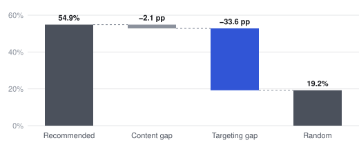

# Exploration budget for the short-video feed

Decision memo · Hanson Yang · December 2026

**Bottom line.** Exploration is cheap at today's share and almost all of its cost is a targeting problem, so the next step is to target exploration, not cut it.

## Recommendation

1. **Exploration up to 1.388% of the feed is safe to keep.** No guardrail was crossed at that share, the highest in the data. It lowers the feed's effective-view rate by 0.48 pp (0.88% of its current rate), or 4.8 effective views per 1,000 impressions. Its payoff is long-run and was not measured here.
2. **Keep dance videos out of the random pool.** They are the only content where hate clearly passes its limit.
3. **Next, test 2-3% targeted exploration.** Most of the cost is who sees the video, not the video.

## Context

KuaiRand is a public dataset of viewing logs from Kuaishou, a large short-video app. For a small share of feed requests, the app swapped a recommended video for a random one, so each random slot is a measured exploration slot (26,955 users, 1,081,088 random requests, April 23 to May 8, 2022).

## What we found

- **A random slot costs 34.6 pp of effective views (−63%).** Recommended slots get 54.8%. Randomized · both methods agree · pre-registered · holds across robustness variants
- **94% of that gap is targeting, not content.** In the best case, where a targeted slot reaches people as well as the recommender does, a slot would cost about 2.1 pp instead of 35.7 pp. That is an upper bound on what targeting can save. Randomized · both methods agree · pre-registered · holds across robustness variants
- **Costs vary more by content than by user.** Random gaming videos cost 42.2 pp and comedy 28.3 pp. User groups differ by a few points. Randomized · both methods agree · pre-registered
- **Guardrails hold for the whole feed but not for dance.** At 1.388%, hate rises 1.60% and fast skip 1.32% relative to their current rates, both under the 2% limit. Dance videos push hate past the limit even at 0.658%, the lowest share in the data (+3.3%). Randomized · both methods agree · holds across robustness variants

## What we don't know

- **Anything above 1.388%.** No higher share was observed; that needs a new test.
- **Whether exploration pays off later.** Random slots also give fewer new-category effective views (1.21% vs 1.76% of impressions), so the short-run data shows no discovery benefit. The case for exploration rests on long-run effects that a 16-day window cannot measure.
- **Also:** the periods before and after the May Day rate change are never compared; session exits cannot be identified (decision D53); this is one app, in 2022.

## Next experiment

Randomize by user for about four weeks, with dance excluded from the random pool in every arm.

| Arm | Exploration share | Pool videos chosen |
|---|---|---|
| Control | 1.388% | at random (current policy) |
| Random 2% | 2% | at random |
| Targeted 2% | 2% | matched to the user's interests |
| Targeted 3% | 3% | matched to the user's interests |

Random 2% vs targeted 2% measures what targeting saves; targeted 2% vs targeted 3% measures how far the share can go.

- **Metrics:** effective views per impression (primary); hate and fast skip within the same 2% limit (guardrails); 14-day retention, first-week views of new creators, and new categories still watched after two weeks (long run).
- **Decision rules, set before launch:** ship targeted 3% if both guardrails stay within the 2% limit and its effective-view loss is no worse than random 2%; ship targeted 2% if only that arm passes; otherwise keep 1.388% random without dance. Long-run metrics decide whether to go further. Pre-register metrics and limits before launch, as here.
- **Slot level, what targeting saves:** 231 users per arm detect a 5 pp difference in a slot's effective-view rate.
- **Feed level, how far the share can go:** 201,921 users per arm detect a 0.2 pp change in a user's effective-view rate (SD 19.6 pp). Hate needs far more: at that size it detects only a 16% change, not the 2% limit, which would take 12.9 million users per arm, so hate is judged on point estimates, as here. Both: 80% power, alpha 0.05 over three comparisons.

## Appendix

### Method

- **Comparison:** each random video against the recommended videos in the same feed request, each user weighted equally.
- **Inference:** a user-clustered bootstrap (2,000 resamples), cross-checked with a fixed-effects regression with errors clustered by user. A result counts only if both methods find it with the same sign.
- **Pre-registration:** metrics, tests and parameters were fixed before any outcome was read (git tag `prereg-v1`). Later changes are logged as deviations.
- **Segments:** each segment is compared with the rest of its group, corrected with Benjamini-Hochberg and the stricter Benjamini-Yekutieli.
- **Primary metric:** duration-adjusted effective view: a view that lasts at least as long as the typical view of a similar-length video, so short videos are not favored the way plain completion favors them.

### Where a random slot loses effective views

Same-day sample, 22,335 users; the 54.8% on page 1 compares within the same feed request.

### Robustness

| Variant | Effective view | Hate |
|---|---|---|
| Main | −34.6 pp [−34.8, −34.5] | +0.058 pp [+0.044, +0.073] |
| Excluding the AD pool | −34.6 pp [−34.8, −34.4] | +0.058 pp [+0.044, +0.072] |
| Excluding the top 0.1% of user-days | −34.6 pp [−34.8, −34.5] | +0.058 pp [+0.044, +0.073] |
| Within user | −35.5 pp [−35.7, −35.4] | +0.056 pp [+0.041, +0.071] |

Random minus recommended, 95% intervals. Every variant agrees in sign and in both methods.

### Data quality

- **Randomization:** 99.3% of random insertions are on the main feed tab (tab 1), which is the only tab analyzed.
- **Missing duration:** 7.81% of recommended rows and 3.11% of random rows lack a duration. Duration-based metrics such as effective view use only rows with a duration; metrics that do not need one, such as hate, give the same answer with those rows included.
- **Insertion rate:** 0.630% of tab-1 exposures until May 1 and 1.388% from May 3. Comparisons stay within the same request or day, so the two periods are never compared.

### Links

- Dashboard: <https://hansonyjy.github.io/feed-exploration-experiment/>
- Findings: [docs/findings.md](findings.md)
- Decision log: [docs/decisions.md](decisions.md)
- Pre-registered plan: [docs/analysis_plan.md](analysis_plan.md), tag `prereg-v1`
- Scripts behind the memo's numbers: [scripts/memo_facts.py](../scripts/memo_facts.py), [scripts/power_next_experiment.py](../scripts/power_next_experiment.py)
